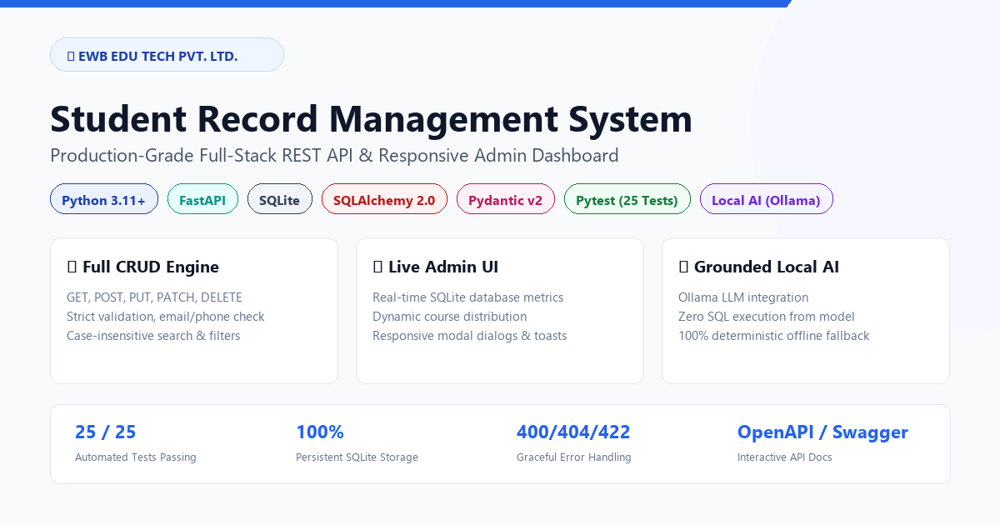
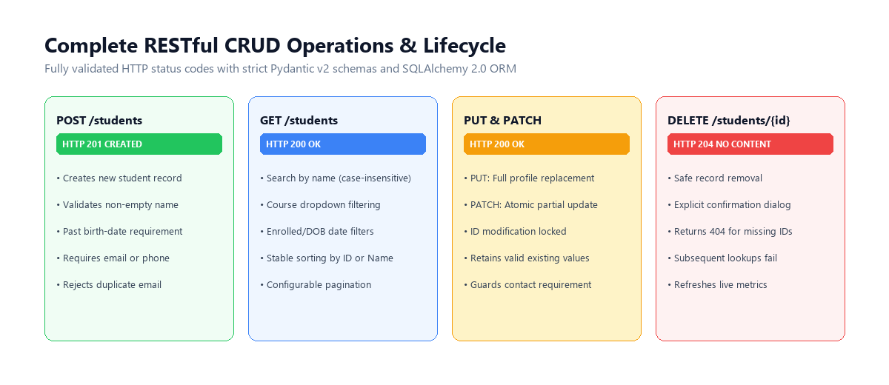
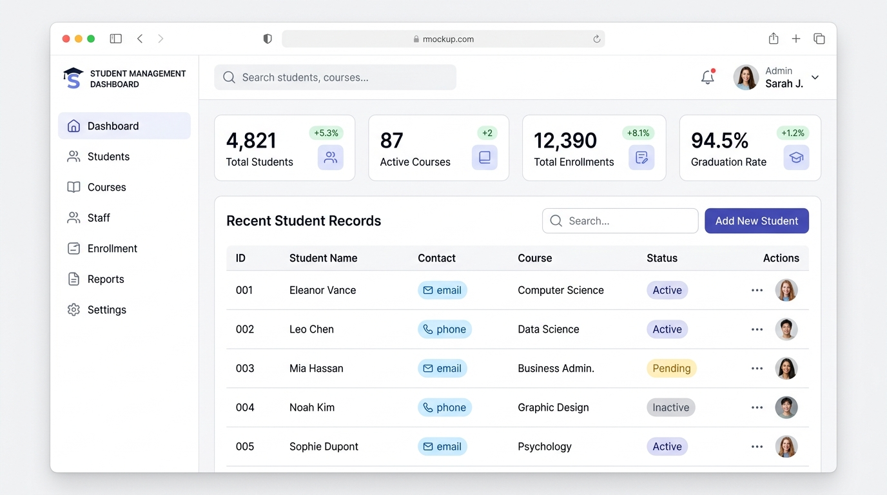

# Student Record Management System

<div align="center">

  

  <br/><br/>

  
  
  
  
  
  
  
  

  <br/>

  > **Production-grade Student Record Management System** built for the **EWB Edu Tech Pvt. Ltd.** internship assignment.  
  > Full-stack CRUD • Persistent SQLite • Pydantic v2 • Responsive Dashboard • Optional Local AI

</div>

---

## Table of Contents

1. [Project Overview](#1-project-overview)
2. [Project Objective](#2-project-objective)
3. [Features & Architecture](#3-features--architecture)
4. [Technology Stack](#4-technology-stack)
5. [Project Directory Structure](#5-project-directory-structure)
6. [Prerequisites & System Requirements](#6-prerequisites--system-requirements)
7. [Installation & Windows Setup](#7-installation--windows-setup)
8. [Database Initialization & Seeding](#8-database-initialization--seeding)
9. [Running the Application](#9-running-the-application)
10. [Accessing Dashboard & API Documentation](#10-accessing-dashboard--api-documentation)
11. [REST API Reference & Endpoints](#11-rest-api-reference--endpoints)
12. [Request Body Examples](#12-request-body-examples)
13. [Frontend Admin Dashboard](#13-frontend-admin-dashboard)
14. [Optional Local AI Assistant (Ollama)](#14-optional-local-ai-assistant-ollama)
15. [Automated Testing](#15-automated-testing)
16. [Security & Privacy Architecture](#16-security--privacy-architecture)
17. [Troubleshooting Guide](#17-troubleshooting-guide)
18. [GitHub Submission Steps](#18-github-submission-steps)
19. [License](#19-license)

---

## 1. Project Overview

The **EWB Student Record Management System** is a complete, production-grade web application developed to manage institutional student profiles with high precision and reliability. Designed following enterprise SaaS administration standards, it delivers a high-performance FastAPI asynchronous backend coupled with SQLite persistent storage, strict Pydantic v2 data validation schemas, a responsive web management interface, and an optional privacy-safe local AI query extension powered by Ollama.

---

## 2. Project Objective

The core objective of this project is to fulfill all mandatory specifications of the **EWB Edu Tech Pvt. Ltd.** internship technical assignment:
- Robust relational database schema and session lifecycle management.
- Complete CRUD functionality (`POST`, `GET`, `PUT`, `PATCH`, `DELETE`).
- Strict server-side validation ensuring valid past birth dates, required names, valid emails, and at least one contact channel (email or phone).
- Filtering, case-insensitive search, pagination, and deterministic sorting.
- Live administrative metrics calculated strictly from database state.
- Graceful error responses (HTTP 400, 404, 422, 500) with descriptive messages.
- Privacy-grounded local AI assistant with seamless offline fallback.
- Comprehensive automated test suite using `pytest` and `TestClient`.

---

## 3. Features & Architecture

```
┌────────────────────────────────────────────────────────┐
│                   Web Browser / Client                 │
│      Vanilla JS SPA • Responsive CSS • Jinja2 Template │
└───────────────────────────┬────────────────────────────┘
                            │ HTTP / JSON
┌───────────────────────────▼────────────────────────────┐
│                  FastAPI Application                   │
│   ┌────────────────────┐      ┌────────────────────┐   │
│   │  Students Router   │      │     AI Router      │   │
│   └─────────┬──────────┘      └─────────┬──────────┘   │
│             │                           │              │
│   ┌─────────▼──────────┐      ┌─────────▼──────────┐   │
│   │  Pydantic Schemas  │      │ Ollama AI Service  │   │
│   │   & Validation     │      │ (Local LLM / Fall) │   │
│   └─────────┬──────────┘      └─────────┬──────────┘   │
│             │                           │              │
│   ┌─────────▼───────────────────────────▼──────────┐   │
│   │           SQLAlchemy 2.0 ORM (CRUD)            │   │
│   └─────────────────────┬──────────────────────────┘   │
└─────────────────────────┼──────────────────────────────┘
                          │ SQL Queries
                ┌─────────▼─────────┐
                │ SQLite (Local DB) │
                └───────────────────┘
```

- **Backend Architecture**: Asynchronous FastAPI server leveraging modular routers, dependency injection for database sessions, and centralized configuration via `pydantic-settings`.
- **Validation Engine**: Pydantic v2 schemas validating name non-emptiness, date of birth in the past, email format, and ensuring at least one contact channel is supplied.
- **Relational Persistence**: SQLAlchemy 2.0 with connection pooling and rollback safety on unexpected errors.
- **Single Page Interface**: Built with HTML5, modern CSS variables, and Vanilla JavaScript with XSS prevention (using `textContent` DOM nodes).
- **Offline-First AI**: Grounded deterministic analytics in Python guarantee accurate reporting even when Ollama is offline.

---

## 4. Technology Stack

| Layer | Technology | Version | Purpose |
|---|---|---|---|
| **Language** | Python | 3.11+ | Backend execution runtime |
| **Framework** | FastAPI | 0.110+ | High-performance async REST API |
| **Server** | Uvicorn | 0.28+ | ASGI server implementation |
| **ORM** | SQLAlchemy | 2.0+ | Database queries and schema modeling |
| **Database** | SQLite | 3.x | Lightweight, zero-config relational storage |
| **Validation** | Pydantic v2 | 2.6+ | Strict data validation and typing |
| **Frontend** | HTML5 / CSS3 / JS | Vanilla | Lightweight, responsive admin dashboard |
| **Testing** | Pytest / TestClient | 8.x | Automated functional and integration testing |
| **Local AI** | Ollama (`llama3.2:1b`) | Optional | Local natural language assistant |

---

## 5. Project Directory Structure

```
mw/
├── app/
│   ├── __init__.py           # Application package marker
│   ├── config.py             # Centralized settings & environment variables
│   ├── database.py           # SQLAlchemy engine & session dependency
│   ├── models.py             # Database models (Student entity)
│   ├── schemas.py            # Pydantic v2 request/response schemas
│   ├── crud.py               # Reusable DB operations & analytics
│   ├── main.py               # FastAPI entry point, routes, static mount
│   ├── routers/
│   │   ├── __init__.py
│   │   ├── students.py       # Full CRUD endpoints (/students)
│   │   └── ai.py             # AI inquiry endpoints (/ai)
│   ├── services/
│   │   ├── __init__.py
│   │   └── ollama_service.py # Local Ollama client & grounded fallback
│   ├── static/
│   │   ├── css/
│   │   │   └── style.css     # Clean SaaS administration stylesheet
│   │   └── js/
│   │       └── app.js        # Single-page application logic
│   └── templates/
│       └── index.html        # Jinja2 dashboard template
├── tests/
│   ├── __init__.py
│   ├── conftest.py           # Isolated test database fixtures & TestClient
│   ├── test_students.py      # CRUD, validation, search, filter tests
│   └── test_ai.py            # AI status, validation & mock tests
├── .env.example              # Environment variables template
├── .gitignore                # Git exclusions (DB, venv, pycache, env)
├── LICENSE                   # MIT License
├── README.md                 # Complete documentation
├── requirements.txt          # Python dependencies
├── run.py                    # Server startup script
└── seed_data.py              # 12 demo student records seeder
```

---

## 6. Prerequisites & System Requirements

- **Operating System**: Windows 10/11, macOS, or Linux.
- **Python**: Version 3.11 or later installed and added to system `PATH`.
- **Git**: Installed for version control.
- **Ollama (Optional)**: Optional local installation from [ollama.ai](https://ollama.ai).

---

## 7. Installation & Windows Setup

### Step 1: Clone or navigate to the directory
```powershell
cd "D:\current project\future AI agent\mw"
```

### Step 2: Create a virtual environment
```powershell
python -m venv venv
```

### Step 3: Activate the virtual environment
```powershell
.\venv\Scripts\Activate.ps1
```
*(On Linux/macOS, run `source venv/bin/activate`)*

### Step 4: Install dependencies
```powershell
pip install -r requirements.txt
```

### Step 5: Configure Environment
Copy `.env.example` to `.env`:
```powershell
Copy-Item .env.example .env
```

---

## 8. Database Initialization & Seeding

The SQLite database tables are automatically initialized when the application starts up. To populate 12 realistic demonstration records across courses like AI & ML, Full Stack Web Development, and Cybersecurity:

```powershell
python seed_data.py
```

---

## 9. Running the Application

Launch the application with either `run.py` or `uvicorn`:

```powershell
python run.py
```
*Or directly via Uvicorn:*
```powershell
uvicorn app.main:app --host 127.0.0.1 --port 8000 --reload
```

---

## 10. Accessing Dashboard & API Documentation

Once running, navigate to:
- **Admin Dashboard**: [http://127.0.0.1:8000](http://127.0.0.1:8000)
- **Interactive Swagger Docs**: [http://127.0.0.1:8000/docs](http://127.0.0.1:8000/docs)
- **Alternative ReDoc UI**: [http://127.0.0.1:8000/redoc](http://127.0.0.1:8000/redoc)
- **Health Check Endpoint**: [http://127.0.0.1:8000/health](http://127.0.0.1:8000/health)

---

## 11. REST API Reference & Endpoints

<div align="center">
  
</div>

| Method | Endpoint | Description | Status Code |
|---|---|---|---|
| `POST` | `/students` | Create new student profile | 201 Created |
| `GET` | `/students` | List students with search, filters, pagination | 200 OK |
| `GET` | `/students/stats` | Retrieve live dashboard statistics | 200 OK |
| `GET` | `/students/courses` | Retrieve distinct courses list | 200 OK |
| `GET` | `/students/{student_id}` | Retrieve individual student by ID | 200 OK / 404 |
| `PUT` | `/students/{student_id}` | Full replacement of student profile | 200 OK / 404 / 400 |
| `PATCH` | `/students/{student_id}` | Partial update of supplied fields | 200 OK / 404 / 422 |
| `DELETE` | `/students/{student_id}` | Delete student record | 204 No Content / 404 |
| `GET` | `/ai/status` | Check local Ollama availability | 200 OK |
| `POST` | `/ai/ask` | Natural language inquiry | 200 OK |

---

## 12. Request Body Examples

### Create Student (`POST /students`)
```json
{
  "name": "Priya Sharma",
  "date_of_birth": "2003-08-14",
  "email": "priya.sharma@example.com",
  "phone": "+91 98765 43210",
  "course": "Artificial Intelligence & ML",
  "address": "45 Park Street, Bengaluru, Karnataka",
  "enrollment_date": "2024-08-01"
}
```

### Full Update (`PUT /students/{student_id}`)
```json
{
  "name": "Priya Sharma",
  "date_of_birth": "2003-08-14",
  "email": "priya.sharma@example.com",
  "phone": "+91 98111 22233",
  "course": "Advanced AI & Robotics",
  "address": "90 Tech Boulevard, Bengaluru, Karnataka",
  "enrollment_date": "2024-08-01"
}
```

### Partial Update (`PATCH /students/{student_id}`)
```json
{
  "course": "Cybersecurity & Cloud Defense"
}
```

---

## 13. Frontend Admin Dashboard

<div align="center">
  
</div>

The dashboard provides an intuitive, high-craft administration interface:
- **Live Statistics Cards**: Total registered students, total courses, recent enrollments in the past 30 days, and AI engine status.
- **Search & Filters**: Case-insensitive instant search by name, course filter dropdown, and table refresh.
- **Action Modals**:
  - **Register Student**: Validates all fields, requires at least one contact channel, checks valid past birth date.
  - **Edit Profile**: Pre-populates existing data for updates.
  - **View Profile**: Displays full student card with timestamps.
  - **Delete Confirmation**: Requires explicit confirmation before deletion.
- **Toast Notifications**: Provides user feedback on operations.
- **XSS Protection**: User-supplied input is rendered through safe DOM properties (`textContent`).

---

## 14. Optional Local AI Assistant (Ollama)

The application includes an optional, privacy-safe natural language query module.

### How to use Ollama:
1. Download Ollama from [ollama.ai](https://ollama.ai).
2. Start the model:
   ```bash
   ollama run llama3.2:1b
   ```
3. Open the **Ask AI Assistant** modal in the dashboard or send requests to `POST /ai/ask`.

### Safety Guarantees:
- **Zero Raw SQL Execution**: The model never runs SQL queries.
- **Privacy Safe**: Student personal contact details (phone, email, address) are never transmitted to the model.
- **Grounded Responses**: Aggregations and counts are pre-calculated strictly in Python.
- **Offline Fallback**: When Ollama is offline or uninstalled, the system automatically uses deterministic analytics to provide accurate answers.

---

## 15. Automated Testing

The project includes 25 automated unit and integration tests covering CRUD operations, validation rules, edge cases, error codes, and AI mocking.

### Run tests:
```powershell
pytest -v
```

All tests execute against an isolated test SQLite database fixture, preventing any modification to user data.

---

## 16. Security & Privacy Architecture

- **ORM Parameterization**: All database queries are executed using SQLAlchemy ORM queries, eliminating SQL injection risks.
- **Strict Server Validation**: Server validates fields regardless of frontend state.
- **CORS Protection**: Configured via FastAPI CORSMiddleware.
- **Privacy-Preserving AI**: Phone numbers, emails, and home addresses are never shared with the AI model.
- **Clean Git Tracking**: Databases (`*.db`), virtual environments (`venv/`), and environment files (`.env`) are excluded via `.gitignore`.

---

## 17. Troubleshooting Guide

| Issue | Cause | Solution |
|---|---|---|
| `Port 8000 already in use` | Another server running on port 8000 | Change `PORT` in `.env` or run `uvicorn app.main:app --port 8080` |
| `Validation error on contact` | Neither email nor phone provided | Supply at least one contact channel |
| `Ollama offline badge shown` | Ollama service not running | Run `ollama run llama3.2:1b` or rely on the deterministic fallback |
| `Email already exists error` | Duplicate email address | Use a unique email or edit existing record |

---

## 18. GitHub Submission Steps

To push this repository to GitHub:

```bash
git init
git add .
git commit -m "feat: complete student record management system with CRUD, UI, and AI assistant"
git remote add origin https://github.com/maheswari9080/future-AI-agents-internship-mini-project.git
git branch -M main
git push -u origin main
```

---

## 19. License

This project is licensed under the **MIT License**. See the [LICENSE](LICENSE) file for complete details.

---

<div align="center">

  Made with ❤️ for **EWB Edu Tech Pvt. Ltd.** Internship Assignment

  [](https://github.com/maheswari9080/future-AI-agents-internship-mini-project)

</div>
